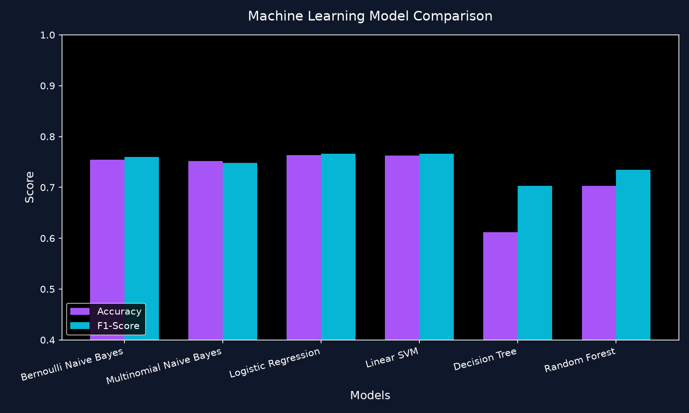
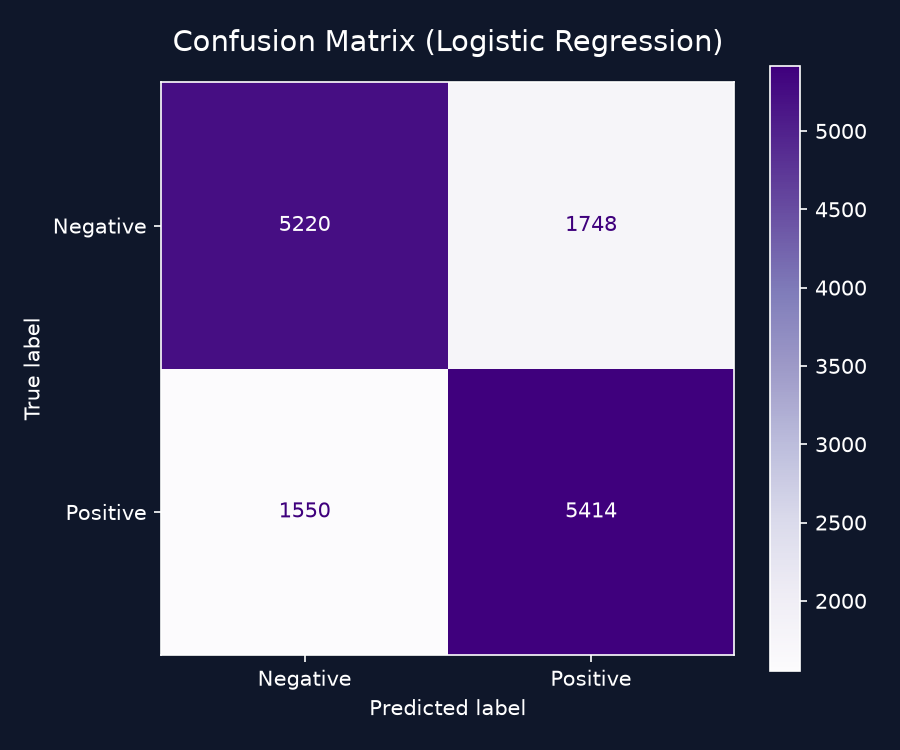
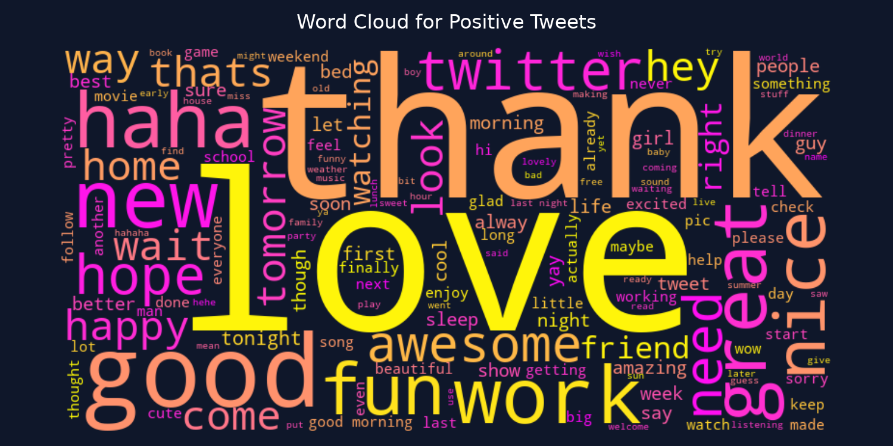

# SentimenTweet: Twitter Sentiment Analysis End-to-End Platform

SentimenTweet is a production-ready, modular, end-to-end sentiment analysis platform. It cleans, processes, and vectorizes raw social media data, trains six classical machine learning models (with automated hyperparameter tuning and model selection), and serves predictions through an interactive glassmorphic web dashboard.

---

## 📁 Project Structure

```
Twitter-Sentiment-Analysis/
│
├── data/
│   └── training.1600000.processed.noemoticon.csv   # Dataset (Sentiment140)
│
├── models/
│   ├── sentiment_model.pkl                          # Automatically saved best model
│   ├── vectorizer.pkl                               # Fitted TF-IDF Vectorizer
│   ├── model_*.pkl                                  # Serialized backup models
│   ├── model_comparison.json                        # Evaluation metrics for dashboard
│   └── training.log                                 # Training console log output
│
├── src/
│   ├── preprocess.py                                # Advanced text cleaning & lemmatization
│   ├── train.py                                     # Training pipeline & grid search tuning
│   ├── predict.py                                   # Inference wrapper with confidence score scaling
│   ├── evaluate.py                                  # Matplotlib chart & wordcloud generator
│   └── utils.py                                     # Logging and system utility helpers
│
├── templates/
│   └── index.html                                   # Glassmorphism HTML layout
│
├── static/
│   ├── css/
│   │   └── style.css                                # Glassmorphism theme & light/dark toggle
│   └── js/
│       └── main.js                                  # SPA tab routing, AJAX predictions, Chart.js
│
├── screenshots/                                     # Saved visualization images & word frequencies
│   ├── class_distribution.png
│   ├── tweet_length_distribution.png
│   ├── wordcloud_positive.png
│   ├── wordcloud_negative.png
│   ├── top_positive_words.png
│   ├── top_negative_words.png
│   ├── model_comparison.png
│   ├── confusion_matrix.png
│   └── word_frequencies.json
│
├── app.py                                           # Flask Web Server
├── requirements.txt                                 # Project dependencies
└── README.md                                        # Documentation
```

---

## 📊 Dataset Information

This project is built around the **Sentiment140** dataset, which consists of 1,600,000 tweets annotated with binary polarity (0 = negative, 4 = positive).
- **Size**: 238 MB
- **Balanced**: Exactly 800,000 negative and 800,000 positive tweets.
- **Fields**: Polarity, ID, Date, Query, User, Text.

> **Note:** The dataset is **not included** in this repository due to its size (~228 MB). Pre-trained models are included, so you can run predictions immediately without downloading the data. You only need the dataset if you want to retrain models.

### Download the Dataset (required for training only)

1. Download the Sentiment140 training file from [sentiment140.com](http://help.sentiment140.com/for-students/) (file: `training.1600000.processed.noemoticon.csv`).
2. Create a `data/` folder in the project root if it does not exist.
3. Place the CSV file at:
   ```
   data/training.1600000.processed.noemoticon.csv
   ```

---

## ⚡ Key Features

1. **Advanced Text Processing**:
   - URL & Mentions extraction.
   - Hashtag recovery (e.g., `#success` $\rightarrow$ `success`).
   - HTML entities removal.
   - Punctuation, numbers, emojis removal.
   - English stopwords filtering and word lemmatization (using NLTK WordNet).

2. **Feature Engineering**:
   - Fitted on a TF-IDF vectorizer of 10,000 max features, sublinear term frequency scaling, and word n-grams range of (1,2).

3. **Multi-Model Training Pipeline**:
   - Trains 6 distinct classifiers: **Bernoulli Naive Bayes, Multinomial Naive Bayes, Logistic Regression, Linear SVM, Decision Tree, and Random Forest**.
   - Grid search hyperparameter tuning (`GridSearchCV`) for Logistic Regression, SVM, and Random Forest.
   - Automatic model comparison and serialization of the best model.

4. **Interactive Glassmorphic Interface**:
   - Default deep indigo dark mode (switchable to light mode).
   - Real-time prediction (predict-while-typing with debounced inputs).
   - Dynamic SVG confidence gauge indicator.
   - Client-side prediction history cached in `localStorage` with CSV spreadsheet downloader.
   - Batch CSV file uploading with drag-and-drop zone support, paginated results, and prediction exports.
   - Analytics dashboard displaying Chart.js interactive charts and dataset word clouds.
   - Training Console to trigger retraining on custom sample sizes and scroll training build stdout in real-time.

---

## 🛠️ Installation & Setup

### 1. Prerequisites
Ensure you have **Python 3.8+** installed.

### 2. Clone the Repository
```bash
git clone https://github.com/Shashankgupta09/Twitter-Sentiment-Analysis.git
cd Twitter-Sentiment-Analysis
```

### 3. Install Dependencies
```bash
pip install -r requirements.txt
```

### 4. (Optional) Download the Dataset
Only needed if you plan to retrain models. See [Download the Dataset](#download-the-dataset-required-for-training-only) above.

---

## 🚀 How to Run the Platform

### Quick Start (no training required)
Pre-trained models are already included. Start the web app directly:
```bash
python app.py
```
Open your browser at **`http://localhost:5000`**

### 1. Training & Evaluation (Command Line)
Requires the dataset in `data/`. You can trigger training from the command line:
```bash
# Train on a default balanced sample of 50,000 tweets with tuning enabled
python src/train.py --sample-size 50000 --tune

# Train on the full 1.6-million tweet dataset
python src/train.py --sample-size -1
```

Once training finishes, run the visualization script:
```bash
python src/evaluate.py
```

### 2. Start the Web Dashboard Server
```bash
python app.py
```
Open your browser at **`http://localhost:5000`**

Alternatively, you can start training directly from the **Training Console** page on the web app interface, which will automatically stream logs and generate all visualizations!

---

## 📸 Screenshots

| Model Comparison | Confusion Matrix | Word Cloud |
| :---: | :---: | :---: |
|  |  |  |

---

## 🔍 Example Predictions

| Input Tweet | Cleaned Token | Sentiment Prediction | Confidence Score |
| :--- | :--- | :--- | :--- |
| "I love this product! Check it out at https://example.com #awesome" | `love product check awesome` | **Positive** | `98.24%` |
| "Hello @user, this is &amp; amazing 1234. 😍 I feel so happy!" | `hello amazing feel happy` | **Positive** | `95.10%` |
| "My flight was delayed and I hate waiting at the airport..." | `flight delayed hate waiting airport` | **Negative** | `91.68%` |

---

